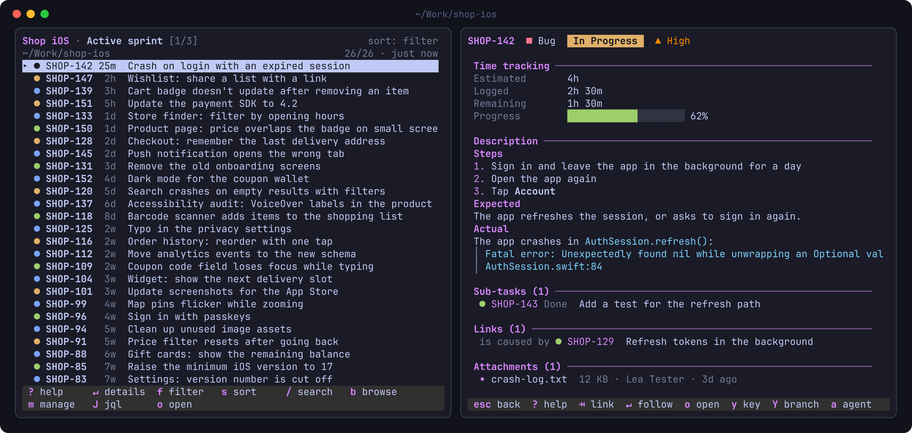

# herdr-jira-light

A lightweight Jira pane for [herdr](https://herdr.dev). Its filters follow the working directory of the tab it sits in: each project gets its own boards and sprints, and switching tabs, spaces or directories switches the list. It is written in zsh with curl and jq, so there is nothing to compile.



```sh
curl -fsSL https://raw.githubusercontent.com/ChristianDeckert/herdr-jira-light/main/install.sh | sh
```

- `prefix+alt+j` shows or hides the pane in the current tab.
- `b` browses projects, their boards and the boards' sprints and backlog, optionally only your issues; `p` pins what you picked to a directory, `m` lists and removes pins.
- `↵` shows an issue with all of its fields, the description rendered, and sub-tasks, links and comments you can follow.
- The bar at the bottom shows the keys that matter where you are; click or tap one to press it. It also offers new versions of the plugin.
- It works with Jira Server/Data Center (personal access token) and Jira Cloud (email + API token).
- It only reads from Jira; nothing is changed there.
- Needs herdr 0.9.4+, zsh, curl and jq on macOS or Linux.

## Compared with herdr-jira

[herdr-jira](https://github.com/a2u/herdr-jira) is the other Jira pane for herdr. Jira Light is built around the directory you work in:

| | Jira Light | herdr-jira |
|---|---|---|
| **Filters** | per directory: `context` blocks in the config, the deepest matching path wins, and the list follows the tab's working directory as you switch tabs, spaces or `cd` | one list of filters for everything; `{project}` comes from a single `default_project` |
| **Getting the JQL** | `b` browses projects → boards → active sprint, future sprints, backlog; "only mine" adds `assignee = currentUser()`; `p` pins the result to a directory and `m` removes pins | written by hand in `config.toml`, or typed with `J` |
| **Install** | zsh, curl and jq; nothing to compile | a Rust toolchain at install time |
| **Details** | every filled field including custom ones (Sprint, Epic Link, …), people, dates, time tracking, the description rendered from wiki markup, sub-tasks, links, attachments and comments; issue keys and URLs can be followed | the description, as plain text |
| **Caching** | results are cached on disk and shared by all panes: a list shows at once when you switch or reopen, is refreshed in the background, and stays visible (marked stale) when Jira can't be reached | fetched again on each switch; nothing is cached |

herdr-jira can do things Jira Light doesn't: change an issue's status, expand epics inline, search text on the server, and start a new agent in a directory you pick. Jira Light only reads from Jira.

## Install

The installer:
1. installs the plugin with `herdr plugin install` (herdr shows what it runs and asks first);
2. adds a `prefix+alt+j` binding to `~/.config/herdr/config.toml` if that key is free, after backing up the file;
3. reloads herdr's config.

Options: `sh -s -- --yes` installs without herdr's prompt, and `sh -s -- --uninstall` removes the plugin and the binding.

Manually:

```sh
herdr plugin install ChristianDeckert/herdr-jira-light
```

```toml
[[keys.command]]
key = "prefix+alt+j"
type = "plugin_action"
command = "christiandeckert.jira-light.toggle"
description = "toggle Jira pane"
```

Then store your token, e.g. in the macOS Keychain. `-w` without a value prompts for it, so it stays out of your shell history:

```sh
security add-generic-password -s jira-pat -a "$USER" -w
```

## Configure

Settings live in `config.zsh` in `$(herdr plugin config-dir christiandeckert.jira-light)`. The file is created from [defaults/config.zsh](defaults/config.zsh) the first time the pane opens, and open panes pick up changes on their own.

```zsh
JIRA_BASE_URL="https://jira.example.com/jira"
JIRA_TOKEN_CMD="security find-generic-password -s jira-pat -w"

# global filters: shown wherever no context matches
filter "My open issues" 'assignee = currentUser() AND resolution = Unresolved ORDER BY updated DESC'

# filters for a directory and everything below it; the deepest matching context wins
context ~/Work/shop-ios "Shop iOS"
filter "Active sprint" 'project = SHOP AND platform = iOS AND sprint in openSprints() ORDER BY updated DESC'
filter "Next sprint"   'project = SHOP AND platform = iOS AND sprint in futureSprints() ORDER BY rank'
```

Filters can also be written for you: see [Browse and pin](#browse-and-pin). A context also lists the global filters after its own; set `JIRA_INHERIT_GLOBAL=0` to turn that off. For Jira Cloud, set `JIRA_AUTH=basic` and `JIRA_EMAIL`. [defaults/config.zsh](defaults/config.zsh) lists every setting, including the templates for branch names and agent prompts.

## Browse and pin

`b` opens a browser for whatever your Jira has, without writing JQL:

1. **Projects**, the ones you used recently first (★).
2. A project's **boards**, plus all of its open issues.
3. A board's **active sprint**, its future sprints, its backlog and all of its issues (a Kanban board: the board and all issues).

Typing narrows each level; `↵` opens, `←` or Backspace goes back, `Esc` closes. On top of the board list and of a board's views, **only mine** (`⇥`, or `↵` on it) limits whichever you pick to `assignee = currentUser()`; it stays on for other boards and projects until you switch it off. Picking a sprint or backlog shows its issues right away, as a view. `p` then pins the view: it asks for a directory (the project you're in, or its git root) and appends a filter for it to `config.zsh`:

```zsh
# pinned from the browser, 2026-10-26
context '/Users/me/Work/shop-ios' 'Shop'
filter 'Shop Scrum · Active sprint' '(project = SHOP) AND sprint in openSprints() ORDER BY Rank ASC'
```

The active sprint is pinned as `openSprints()`, so the filter keeps working when the next sprint starts. Edit the line like any other filter, e.g. to add `AND platform = iOS`. A view that is already pinned to that directory isn't pinned twice.

`m` lists everything pinned this way, grouped by directory. `d` (or Delete) and then `y` removes an entry from `config.zsh`; the file as it was before is kept as `config.zsh.bak`. Hand-written filters aren't listed there.

## Details

`↵` shows an issue the way its Jira page does: the status as a colored badge, priority and type, the issue's link, and sections for details (every filled field, custom fields such as Sprint, Platform or Epic Link included), people, dates, time tracking with a progress bar, the description rendered from Jira's wiki markup, sub-tasks, links, attachments and comments (newest first).

Issue keys (parent, epic, sub-tasks, links) and URLs are links: click them, or walk them with `⇥` / `⇧⇥` and follow with `↵`. A followed issue opens in the same view and `Esc` goes back to the previous one.

## Keys

`?` in the pane shows all of them. The bar at the bottom shows the keys that matter where you are; click or tap one to press it.

**List**

| Key | Action |
|---|---|
| `↑` `↓` `j` `k`, wheel | move |
| `g` `G`, `Home` `End`, `PgUp` `PgDn` | first / last, page |
| `↵` `l`, click | details (see above) |
| `f` `⇥` / `F`, `1`–`9` | next / previous filter, pick one |
| `s` / `S` | next sort (filter, updated, created, priority, rank, key, status) / reverse it |
| `/` | search the loaded issues, every word must match; `Esc` clears it |
| `J` | type a JQL query, prefilled with the current one |
| `b` | browse projects, boards and sprints |
| `p` | pin the current view (from `b` or `J`) to a directory |
| `m` | manage pinned filters |
| `r` / `R` | fetch again / reload the config and check for a new version |
| `u` | update the plugin, when the bar offers it |
| `o` | open the issue in the browser |
| `y` / `Y` | copy the key / a branch name (`feature/APP-123-fix-login`) |
| `a` | send the issue to an agent in this tab (or workspace) as a prompt |
| `q` | close the pane |

**Details**

| Key | Action |
|---|---|
| `↑` `↓` `j` `k` `Space`, wheel | scroll |
| `⇥` / `⇧⇥` | next / previous link |
| `↵`, click | follow the link |
| `Esc` `←` `h` `q` | back |
| `o` `y` `Y` `a` `r` | open, copy key / branch, send to agent, fetch again |

**Browser**

| Key | Action |
|---|---|
| typing | narrow the list |
| `↵` `→`, click | open |
| `⇥` | only mine (board list and a board's views) |
| `←` `⌫` | back one level |
| `Esc` | clear the typing, then close |

**Pinned filters** (`m`)

| Key | Action |
|---|---|
| `↑` `↓` `j` `k`, wheel, click | move |
| `d` `⌫` `Delete`, then `y` | remove the entry from `config.zsh` |
| `Esc` `←` `q` | back |

## How it works

- The pane watches the focused pane of its own tab (the one you last worked in) and uses its current directory, so it follows `cd`.
- Results are cached in herdr's plugin state folder. A list appears from the cache at once and is fetched again in the background when it's older than `JIRA_REFRESH_SECS` (default 180). When Jira can't be reached, the last result stays visible, marked stale, with the error.
- The token is read with `JIRA_TOKEN_CMD` and passed to curl on stdin, so it never shows up in the process list.
- Sorting changes the query's `ORDER BY` and fetches again, since Jira returns at most `JIRA_MAX_RESULTS` issues.
- After a herdr server restart, the startup hook replaces Jira panes that herdr restored as plain shells.
- When a pane starts, every 6 hours, and on `R`, it compares the installed commit (`herdr plugin list --json`) with the repository's latest one using a single `git ls-remote` to github.com; if they differ, it reads the version from the new `herdr-plugin.toml`. Panes share the result in the plugin's state folder. Local or linked installs aren't checked, and `JIRA_UPDATE_CHECK=off` turns the check off.
- A new version shows as `u update to x.y.z` above the keys in the list's bar. `u`, or a click on it, runs `herdr plugin update` in the pane, which shows what changed and asks first. Every open pane then restarts on the new version, keeping its filter and sort; panes of a linked checkout restart the same way when its files change.

## Development

```sh
herdr plugin link .     # use this checkout instead of the GitHub install
zsh tests/run.zsh       # tests for context matching, sorting, slugs, parsing, pinning
```

With the checkout linked, open panes restart within a few seconds of a saved change, once the files pass `zsh -n`.
